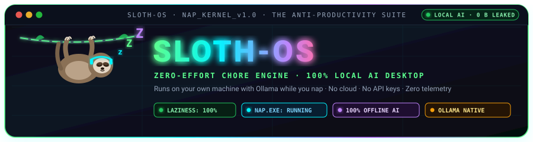
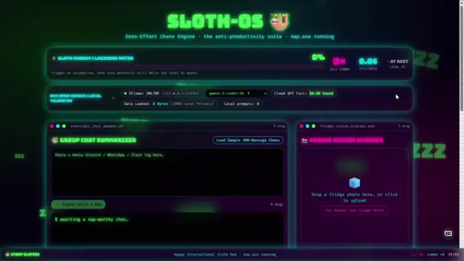

<div align="center">
  
</div>

A neon-soaked fake operating system that quietly does your chores with a **local** AI model while you nap.

Built for International Sloth Day. No accounts, no cloud, no API keys — the model runs on your own machine.

## Demo

[](https://drive.google.com/file/d/1l1vTQKlewrfUcfoE_EqD87--v4-T66di/view?usp=sharing)

_Click the preview to watch the walkthrough on Google Drive._

<!-- GitHub removes <iframe> and <video> tags, so a Drive link cannot autoplay here.
     For a native inline player: upload the MP4 to a GitHub issue or comment, then
     paste the resulting https://github.com/user-attachments/assets/... URL on its
     own line in this section. -->

```
┌──────────────────────────────────────────────────────────────┐
│  SLOTH-OS · zero-effort chore engine · nap.exe running       │
├───────────────────────────────┬──────────────────────────────┤
│  overnight_chat_daemon.sh     │  fridge_vision_scanner.exe   │
├───────────────────────────────┴──────────────────────────────┤
│  clutter_vacuum.py                                           │
├──────────────────────────────────────────────────────────────┤
│  wind_down_synth.wav                                         │
└──────────────────────────────────────────────────────────────┘
```

## Contents

- [Demo](#demo)
- [What it does](#what-it-does)
- [How it works](#how-it-works)
- [Requirements](#requirements)
- [Quick start](#quick-start)
- [Configuration](#configuration)
- [Scripts](#scripts)
- [Project layout](#project-layout)
- [Tests](#tests)
- [Production build](#production-build)
- [Privacy and secrets](#privacy-and-secrets)
- [Troubleshooting](#troubleshooting)
- [License](#license)

## What it does

Four draggable "windows", each turning a lazy-person chore into one button:

| Window                        | What you give it               | What you get                                                   |
| ----------------------------- | ------------------------------ | -------------------------------------------------------------- |
| **overnight_chat_daemon.sh**  | A chaotic group chat           | Two bullet points: what matters, and what to ignore            |
| **fridge_vision_scanner.exe** | A fridge photo (or the sample) | A five-item grocery list and a zero-effort meal idea           |
| **clutter_vacuum.py**         | Messy filenames and emails     | Clean names, target folders, and a short verdict on each       |
| **wind_down_synth.wav**       | Nothing, just vibes            | Rain + a 432 Hz binaural drone and a bedtime story, read aloud |

Around the windows:

- **Laziness meter** — climbs while you sit still, drops when you touch the mouse or keyboard.
- **Idle combo** — increments each time a model run finishes without you moving. Five clicks in five seconds, or a fast mouse sweep, triggers **CRITICAL ALERT: HIGH PRODUCTIVITY DETECTED**, which stays up until you keep still for five seconds.
- **Status bar** — whether Ollama is reachable, which model is in use, prompts run, and the imaginary cloud-API cost you avoided.
- **Taskbar** — the clock, your laziness percentage, and a `START (later)` button that does nothing, on purpose.

## How it works

Sloth-OS is a TanStack Start / React 19 app that renders in the browser. It has no database, no auth, and no backend of its own. The only network traffic it makes is to a local [Ollama](https://ollama.com) server:

```
  browser                                  local machine
┌───────────────┐   GET  /api/tags      ┌────────────────────┐
│   Sloth-OS    │ ────────────────────▶ │ Ollama             │
│  React + TS   │                       │ llama3.2:3b        │
│               │   POST /api/generate  │ (optional vision   │
│               │ ────────────────────▶ │  model)            │
│               │ ◀──────────────────── │                    │
└───────────────┘        text           └────────────────────┘
        │
        └── if Ollama is down or the model is missing:
            show canned fallback copy, UI keeps working
```

Details worth knowing:

- **One text model.** `VITE_OLLAMA_MODEL` (default `llama3.2:3b`) serves every window. There is no model picker and no fallback chain between models.
- **Vision is opt-in.** Fridge photos are sent to `VITE_OLLAMA_VISION_MODEL` only when you configure one and it is installed. Otherwise the scan uses a text prompt with the default "sad fridge" inventory — the photo never leaves the browser.
- **Everything degrades gracefully.** `ask()` resolves with `live: false` instead of throwing, so each window has offline copy to show. That is why the status line reads `[OFFLINE FALLBACK]`.
- **No streaming.** Requests use `stream: false` and a timeout (25 s text, 45 s vision). Short `num_predict` values keep small models snappy.
- **Sound is generated, not downloaded.** The rain is filtered brown noise, and the drone is a 432 Hz / 426 Hz stereo pair producing a ~6 Hz beat, all built with the Web Audio API in `src/lib/ambient.ts`.

## Requirements

| Requirement | Notes                                                     |
| ----------- | --------------------------------------------------------- |
| Node.js 20+ | Node 24 tested. npm 10+ recommended.                      |
| Ollama      | Optional, but without it every window shows offline copy. |
| ~2 GB disk  | For `llama3.2:3b`. A vision model needs another 4–5 GB.   |

## Quick start

```sh
git clone https://github.com/<your-user>/sloth-os.git
cd sloth-os
npm install

# In a second terminal: start the model server and pull the model once.
ollama serve
ollama pull llama3.2:3b

cp .env.example .env      # Windows: copy .env.example .env
npm run dev
```

Open <http://localhost:8080>.

If you skip Ollama entirely the desktop still loads, the meter still works, and every window answers with its canned copy.

## Configuration

Copy `.env.example` to `.env`. Vite reads these at startup, so restart `npm run dev` after changing them.

| Variable                   | Default                  | Purpose                                                            |
| -------------------------- | ------------------------ | ------------------------------------------------------------------ |
| `VITE_OLLAMA_HOST`         | `http://localhost:11434` | Where the Ollama API lives. No trailing slash needed.              |
| `VITE_OLLAMA_MODEL`        | `llama3.2:3b`            | The single text model used by all four windows.                    |
| `VITE_OLLAMA_VISION_MODEL` | _(empty)_                | Optional multimodal model for real fridge photos, e.g. `llava:7b`. |

Model notes:

- Any Ollama model works. Instruction-tuned models follow the "exactly two bullets" and JSON-only instructions best.
- If responses feel slow, drop to `llama3.2:1b`; if the clutter sorter returns broken JSON, try `qwen2.5-coder:3b`.
- Vision models include `llava`, `moondream`, and `gemma3`. Setting `VITE_OLLAMA_VISION_MODEL` without pulling it simply leaves vision off.

## Scripts

| Command              | What it does                                      |
| -------------------- | ------------------------------------------------- |
| `npm run dev`        | Dev server with HMR on port 8080                  |
| `npm run build`      | Production client and server bundles into `dist/` |
| `npm run preview`    | Serve the production build locally                |
| `npm run typecheck`  | `tsc --noEmit`                                    |
| `npm run lint`       | ESLint + Prettier checks                          |
| `npm run format`     | Rewrite files with Prettier                       |
| `npm test`           | Run the Vitest suite once                         |
| `npm run test:watch` | Vitest in watch mode                              |

## Project layout

```
├─ docs/
│  └─ demo-thumbnail.jpg       poster frame for the demo video
├─ public/
│  └─ favicon.svg
├─ src/
│  ├─ components/
│  │  ├─ button-styles.ts      shared button classes
│  │  ├─ chat-daemon.tsx       window 1: group chat summarizer
│  │  ├─ clutter-vacuum.tsx    window 3: filename sorter
│  │  ├─ fridge-scanner.tsx    window 2: fridge photo scanner
│  │  ├─ laziness-meter.tsx    meter, combo and stillness readout
│  │  ├─ live-status.tsx       “live model” vs “offline fallback” label
│  │  ├─ sloth-provider.tsx    mouse/keyboard tracking + automation state
│  │  ├─ status-bar.tsx        Ollama connection and model pill
│  │  ├─ taskbar.tsx           clock and laziness footer
│  │  ├─ warning-modal.tsx     the productivity alarm
│  │  ├─ wind-down-synth.tsx   window 4: rain, drone and bedtime story
│  │  └─ window.tsx            draggable window chrome
│  ├─ hooks/
│  │  └─ use-chore.ts          busy/status/fallback plumbing shared by windows
│  ├─ lib/
│  │  ├─ ambient.ts            Web Audio rain + binaural drone
│  │  ├─ clutter.ts            sorting rules, JSON recovery
│  │  ├─ clutter.test.ts
│  │  ├─ fridge.ts             grocery parsing, sample fridge image
│  │  ├─ fridge.test.ts
│  │  ├─ ollama.ts             status check and generate calls
│  │  ├─ prompts.ts            prompts and offline copy
│  │  └─ sample-chat.ts        the 300-message demo chat
│  ├─ routes/
│  │  ├─ __root.tsx            HTML shell, fonts, 404 and error pages
│  │  └─ index.tsx             the desktop
│  ├─ test/
│  │  └─ routing.test.ts
│  ├─ routeTree.gen.ts         generated by TanStack Router — do not edit
│  ├─ router.tsx
│  ├─ server.ts                SSR entry with a last-resort error page
│  └─ styles.css               Tailwind v4 theme and neon utilities
├─ .env.example
├─ eslint.config.js
├─ package.json
├─ tsconfig.json
├─ vite.config.ts
└─ vitest.config.ts
```

## Tests

```sh
npm test
```

The suite covers the two pieces most likely to break when you swap models:

- `src/lib/clutter.test.ts` — parsing clean, truncated and fenced JSON, plus the local sorting rules used when a model returns junk.
- `src/lib/fridge.test.ts` — grocery/meal parsing and the empty-reply fallback.
- `src/test/routing.test.ts` — `/` resolves to the desktop rather than the not-found route.

## Production build

```sh
npm run build
npm run preview
```

The build writes a browser bundle to `dist/client` and a Node server entry to `dist/server/server.js`. Any Node host works; see the [TanStack Start hosting docs](https://tanstack.com/start) for platform-specific adapters.

One thing to plan for: the AI calls go from the **visitor's** browser to `http://localhost:11434`. A deployed copy is fully interactive, but real model output only appears for visitors who are running Ollama on their own machine. Everyone else gets the fallback copy. If you want a hosted demo with real inference, put a small proxy in front of a server-side model and keep the credentials on the server.

Fonts (`Bungee`, `Fira Code`) are loaded from Google Fonts, so the page also needs normal internet access for its typography.

## Privacy and secrets

- No analytics, no telemetry, no third-party AI APIs.
- Prompts, chat logs and images stay in the browser or go to `localhost`. Nothing is uploaded to a server.
- `.env` is gitignored; only `.env.example` is committed.
- This project needs **no API keys at all**. If you fork it and add a cloud provider, do not put the key in a `VITE_*` variable — Vite inlines those into the public JavaScript bundle. Use a server route and keep the secret server-side.

Before pushing a fork, check that nothing sensitive is staged:

```sh
git status
git diff --cached
```

## Troubleshooting

| Symptom                                    | Fix                                                                                          |
| ------------------------------------------ | -------------------------------------------------------------------------------------------- |
| Status bar says `OFFLINE`                  | Start Ollama with `ollama serve`, then press the ↻ button.                                   |
| Status bar says `MODEL MISSING`            | Run `ollama pull llama3.2:3b`, or point `VITE_OLLAMA_MODEL` at a model you already have.     |
| Windows always show `[OFFLINE FALLBACK]`   | Same as above. Check the host/port in `.env` matches `ollama list`.                          |
| First response takes 20–30 s               | Normal for a cold model on CPU. The model stays warm for 30 minutes after the first call.    |
| Fridge photo returns the generic groceries | No vision model configured or installed. Set `VITE_OLLAMA_VISION_MODEL` and pull that model. |
| JSON sorting occasionally falls back       | Small models truncate JSON. Try a larger model or one tuned for code/JSON.                   |
| Ollama on another machine isn't reachable  | Set `OLLAMA_ORIGINS` on that host to allow this origin, and update `VITE_OLLAMA_HOST`.       |
| Port 8080 already in use                   | Change `server.port` in `vite.config.ts`.                                                    |

## License

Apache 2.0 — see [LICENSE](LICENSE).
